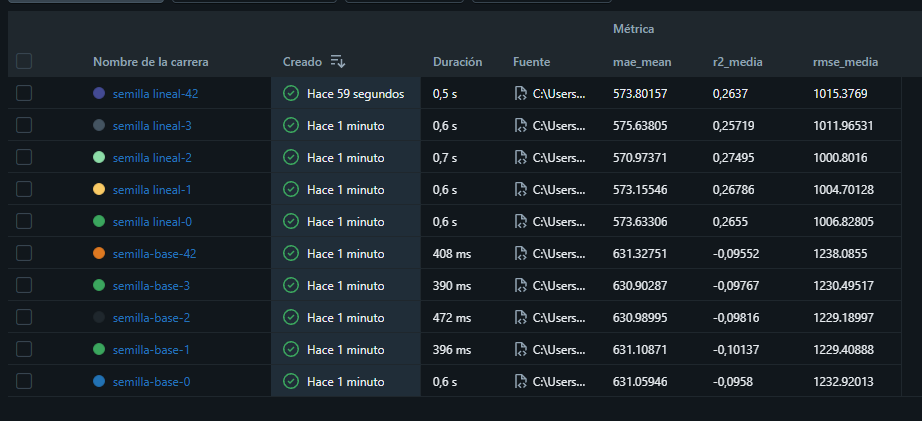

# SentryBox – Pipeline de Machine Learning reproducible

**Curso:** Machine Learning I  
**Entregable:** EC2 – Pipeline de ML reproducible  
**Estudiante:** Mijael Mathias Diaz Aviles  
**Integrante asignado al entregable individual:** 1  
**Rol en el proyecto grupal:** Datos  
**Algoritmo individual:** Regresión lineal (`LinearRegression`)  
**Tipo de problema:** Regresión  
**Variable objetivo:** `ganancia_neta_mes`  

---

## 1. Descripción del proyecto

SentryBox es un proyecto integrador que propone utilizar Machine Learning para estimar la ganancia neta mensual de bodegueros y microcomerciantes minoristas del Perú, como apoyo a la evaluación de su capacidad de pago y al otorgamiento de líneas de capital de trabajo.

El proyecto utiliza información de la Encuesta Nacional de Hogares (ENAHO) 2025 del Instituto Nacional de Estadística e Informática (INEI), específicamente del Módulo 500: Empleo e Ingresos.

Este repositorio corresponde al entregable individual EC2. Como integrante 1, se implementa un modelo de regresión lineal que estima la variable `ganancia_neta_mes`.

El modelo se compara con un baseline que utiliza la mediana de la variable objetivo como predicción constante.

El objetivo es construir un pipeline reproducible para que otra persona pueda instalar las dependencias, preparar los datos, ejecutar los experimentos y obtener resultados consistentes.

## 2. Fuente y descripción de los datos

### 2.1. Fuente original

- Institución: Instituto Nacional de Estadística e Informática (INEI).
- Encuesta: Encuesta Nacional de Hogares (ENAHO) 2025.
- Módulo: 500 – Empleo e Ingresos.
- Archivo original de referencia: `Enaho01a-2025-500.csv`.
- Archivo de trabajo del grupo: `sentrybox_enaho2025.csv`.
- Portal de microdatos: https://proyectos.inei.gob.pe/microdatos/
- Catálogo de datos abiertos: https://www.datosabiertos.gob.pe/dataset/encuesta-nacional-de-hogares-enaho-2025-instituto-nacional-de-estad%C3%ADstica-e-inform%C3%A1tica-%E2%80%93

La ficha pública del conjunto ENAHO 2025 indica la licencia Open Data Commons Open Database License (ODbL). El uso y la redistribución de los datos derivados deben respetar sus condiciones y la atribución correspondiente.

### 2.2. Construcción del subconjunto

El equipo partió de los microdatos originales de la ENAHO 2025, que contienen 84 853 personas y 1 413 columnas.

Se seleccionaron personas ocupadas que trabajan como empleadores o independientes en el comercio al por menor, correspondientes a los códigos CIIU Rev. 4 del 4700 al 4799.

Se obtuvieron inicialmente 4 996 observaciones. Posteriormente, se excluyeron los registros que no informaron ganancias o declararon ganancia cero, obteniendo 4 765 registros.

El archivo `sentrybox_enaho2025.csv` es un subconjunto de trabajo elaborado por el grupo y no representa la base completa de la ENAHO.

La fecha exacta de descarga original del archivo por parte del grupo no quedó registrada en la documentación disponible.

### 2.3. Características del dataset

| Característica | Descripción |
|---|---|
| Archivo | sentrybox_enaho2025.csv |
| Registros | 4 765 |
| Columnas originales | 18 |
| Variables predictoras utilizadas | 16 |
| Variable objetivo | ganancia_neta_mes |
| Valores faltantes | 1 |
| Columna con dato faltante | nivel_educativo |
| Duplicados | 0 |
| Cobertura | Nacional |
| Unidad del objetivo | Soles (S/) |

La variable `ganancia_neta_mes` representa la ganancia neta de la ocupación principal durante el mes anterior, correspondiente a la variable P530A de la ENAHO.

## 3. Variables utilizadas

### 3.1. Variable objetivo

| Variable | Descripción | Tipo |
|---|---|---|
| ganancia_neta_mes | Ganancia neta mensual de la ocupación principal, expresada en soles. | Numérica |

### 3.2. Variables predictoras numéricas

| Variable | Descripción |
|---|---|
| edad | Edad en años cumplidos. |
| horas_semana | Horas trabajadas semanalmente en la ocupación principal. |
| anios_en_ocupacion | Tiempo en años en la ocupación principal. |
| personas_en_negocio | Cantidad de personas que trabajan en el negocio. |

### 3.3. Variables predictoras categóricas

| Variable | Descripción |
|---|---|
| sexo_mujer | Indicador de sexo femenino. |
| estado_civil | Estado civil del encuestado. |
| nivel_educativo | Último nivel educativo aprobado. |
| es_empleador | Indicador de condición de empleador. |
| ayuda_familiar_no_remunerado | Indicador de ayuda familiar sin remuneración fija. |
| registro_sunat | Condición de registro en SUNAT. |
| lleva_libros_contables | Indicador de tenencia de libros contables. |
| tiene_ocupacion_secundaria | Indicador de ocupación secundaria. |
| subsector_ciiu | Código de actividad económica CIIU. |
| dominio | Dominio geográfico. |
| estrato | Estrato geográfico. |
| mes_encuesta | Mes de realización de la encuesta. |

La variable `tiene_trabajadores_pagados` está presente en el CSV original, pero fue excluida de los predictores por presentar colinealidad exacta con `es_empleador` en las 4 765 observaciones.

Por esta razón, el modelo trabaja con 16 variables predictoras: cuatro numéricas y doce categóricas.

## 4. Estructura del repositorio

```text
repro-ml/
│
├── data/
│   ├── raw/
│   │   └── sentrybox_enaho2025.csv
│   │
│   ├── processed/
│   │   └── dataset.csv
│   │
│   └── MANIFIESTO.md
│
├── docs/
│   └── mlflow.png
│
├── results/
│   └── results_summary.csv
│
├── src/
│   ├── __init__.py
│   ├── config.py
│   ├── prepare_data.py
│   ├── train.py
│   └── run_seeds.py
│
├── requirements.txt
├── README.md
└── .gitignore
```

Los datos se organizan en tres zonas:

- RAW: contiene el archivo de trabajo original del repositorio.
- PROCESSED: contiene los datos después de ejecutar la preparación.
- RESULTS: contiene los resultados de los experimentos.

El archivo `mlflow.db` y la carpeta `.venv/` son locales y están excluidos de Git mediante `.gitignore`.

## 5. Requisitos del entorno

El proyecto se desarrolló utilizando:

| Herramienta | Versión |
|---|---|
| Python | 3.14.7 |
| Sistema operativo | Windows |
| NumPy | 2.5.4 |
| Pandas | 3.1.1 |
| Scikit-learn | 1.9.1 |
| MLflow | 3.18.0 |

Las versiones de las librerías están registradas en `requirements.txt`.

## 6. Instrucciones para reproducir el proyecto

### 6.1. Windows (PowerShell)

Clonar el repositorio:

```powershell
git clone https://github.com/mijaeld66-ux/repro-ml-diaz.git
cd repro-ml
```

Si el dataset no está incluido en el repositorio, debe colocarse el archivo `sentrybox_enaho2025.csv` dentro de `data/raw/`, respetando las condiciones de su licencia.

Crear el entorno virtual:

```powershell
py -3.14 -m venv .venv
```

Activar el entorno:

```powershell
.\.venv\Scripts\Activate.ps1
```

Instalar las dependencias:

```powershell
python -m pip install --upgrade pip
pip install -r requirements.txt
```

Definir la semilla de Python antes de iniciar los scripts:

```powershell
$env:PYTHONHASHSEED = "0"
```

Preparar los datos:

```powershell
python -m src.prepare_data
```

Verificar la reproducibilidad ejecutando tres veces el mismo entrenamiento:

```powershell
python -m src.train --seed 42 --modelo lineal
python -m src.train --seed 42 --modelo lineal
python -m src.train --seed 42 --modelo lineal
```

Ejecutar los diez experimentos:

```powershell
python -m src.run_seeds
```

### 6.2. macOS y Linux

Crear el entorno virtual:

```bash
python3.14 -m venv .venv
```

Activarlo:

```bash
source .venv/bin/activate
```

Instalar las dependencias:

```bash
python -m pip install --upgrade pip
pip install -r requirements.txt
```

Definir la semilla:

```bash
export PYTHONHASHSEED=0
```

Preparar los datos:

```bash
python -m src.prepare_data
```

Verificar la reproducibilidad:

```bash
python -m src.train --seed 42 --modelo lineal
python -m src.train --seed 42 --modelo lineal
python -m src.train --seed 42 --modelo lineal
```

Ejecutar los experimentos:

```bash
python -m src.run_seeds
```

### 6.3. Visualización en MLflow

Después de ejecutar los experimentos, abrir una terminal con el entorno virtual activo y ejecutar:

```powershell
mlflow ui --backend-store-uri sqlite:///mlflow.db --host 127.0.0.1 --port 5000
```

Abrir en el navegador:

http://127.0.0.1:5000

El experimento se denomina `pipeline-reproducible`.

La ejecución final genera diez corridas: cinco del baseline y cinco de regresión lineal.

### 6.4. Archivos generados

| Archivo | Descripción |
|---|---|
| data/processed/dataset.csv | Dataset procesado. |
| results/results_summary.csv | Resumen de los diez experimentos. |
| docs/mlflow.png | Evidencia visual de MLflow. |
| mlflow.db | Base de datos local de MLflow, no incluida en Git. |

## 7. Diseño experimental y reproducibilidad

### 7.1. Configuración

- Tipo de tarea: regresión.
- Variable objetivo: `ganancia_neta_mes`.
- Algoritmo: regresión lineal mediante `LinearRegression`.
- Baseline: `DummyRegressor(strategy="median")`.
- Semilla de partición: 42.
- Semillas experimentales: 0, 1, 2, 3 y 42.
- Validación cruzada: cinco particiones.
- Métricas: MAE, RMSE y R².

### 7.2. Partición de los datos

Se utiliza una partición del 80 % para entrenamiento y validación y un 20 % reservado para prueba.

El conjunto del 20 % no se utiliza en este entregable, de acuerdo con las instrucciones de la profesora.

La validación cruzada se realiza sobre el 80 % mediante KFold con cinco particiones, mezclando los datos y utilizando las semillas establecidas.

### 7.3. Preprocesamiento

Las transformaciones se encuentran dentro de un Pipeline de scikit-learn y un ColumnTransformer.

Variables numéricas:
- Imputación mediante la mediana.
- Estandarización con StandardScaler.

Variables categóricas:
- Imputación mediante la categoría más frecuente.
- Codificación OneHotEncoder con handle_unknown="ignore".

El preprocesamiento se ajusta dentro de cada fold utilizando únicamente sus datos de entrenamiento. Esto evita la fuga de información entre entrenamiento y validación.

### 7.4. Reproducibilidad de las ejecuciones
Se realizaron tres ejecuciones consecutivas del modelo
lineal con la semilla 42 y 16 variables predictoras.

Las tres produjeron resultados idénticos:

- MAE medio: 573.80157.
- MAE desviación entre folds: 19.41043.
- RMSE medio: 1015.37690.
- RMSE desviación entre folds: 92.02947.
- R² medio: 0.26370.
- MD5 del dataset procesado:
  5caa212fdfd858bb9a4f218d43c94d8d.
    
### 7.5. Integridad de los datos

Se calcularon las siguientes huellas MD5:

| Archivo | MD5 |
|---|---|
| RAW | 79cb9c9fcccd760795c3a28fdc8b35e3 |
| PROCESSED | 5caa212fdfd858bb9a4f218d43c94d8d |

Estas huellas permiten comprobar que los archivos utilizados mantienen el mismo contenido entre ejecuciones.

## 8. Resultados de los experimentos

Se realizaron diez experimentos: cinco utilizando el baseline y cinco utilizando regresión lineal.

Las semillas fueron 0, 1, 2, 3 y 42.

### 8.1. Resultados por semilla

Los resultados corresponden a la validación cruzada de cinco folds sobre el conjunto de entrenamiento.

| Semilla | Modelo | MAE medio | DE MAE | RMSE medio | DE RMSE | R² medio | DE R² |
|---:|---|---:|---:|---:|---:|---:|---:|
| 0 | baseline | 631.05946 | 67.27055 | 1232.92013 | 162.79982 | -0.09580 | 0.02177 |
| 1 | baseline | 631.10871 | 40.24476 | 1229.40888 | 193.37736 | -0.10137 | 0.03142 |
| 2 | baseline | 630.98995 | 47.19475 | 1229.18997 | 196.00026 | -0.09816 | 0.01257 |
| 3 | baseline | 630.90287 | 49.57325 | 1230.49517 | 184.42108 | -0.09767 | 0.00586 |
| 42 | baseline | 631.32751 | 26.57029 | 1238.08550 | 100.72041 | -0.09552 | 0.01312 |
| 0 | lineal | 573.63306 | 25.53131 | 1006.82805 | 115.72316 | 0.26550 | 0.04579 |
| 1 | lineal | 573.15546 | 36.12379 | 1004.70128 | 179.46142 | 0.26786 | 0.04536 |
| 2 | lineal | 570.97371 | 40.44270 | 1000.80160 | 175.01390 | 0.27495 | 0.03795 |
| 3 | lineal | 575.63805 | 31.17431 | 1011.96531 | 150.63119 | 0.25719 | 0.01752 |
| 42 | lineal | 573.80157 | 19.41043 | 1015.37690 | 92.02947 | 0.26370 | 0.02679 |

Las columnas DE MAE, DE RMSE y DE R² representan las desviaciones estándar entre los cinco folds de cada ejecución.

### 8.2. Media y desviación estándar entre semillas

La siguiente tabla presenta la media y desviación estándar muestral (ddof=1) calculadas a partir de las cinco ejecuciones de cada modelo.

| Modelo | MAE (media ± DE) | RMSE (media ± DE) | R² (media ± DE) |
|---|---:|---:|---:|
| Baseline | 631.07770 ± 0.15966 | 1232.01993 ± 3.69975 | -0.09770 ± 0.00235 |
| Regresión lineal | 573.44037 ± 1.67055 | 1007.93463 ± 5.79208 | 0.26584 ± 0.00645 |

### 8.3. Interpretación de resultados

La regresión lineal obtuvo mejores resultados que el baseline en las cinco semillas evaluadas.

El MAE medio se redujo de 631.07770 a 573.44037, lo que representa una mejora aproximada del 9.13 %.

El RMSE medio se redujo aproximadamente un 18.19 %.

Además, el R² de la regresión lineal fue positivo (0.26584), mientras que el baseline obtuvo un valor negativo (-0.09770).

Los resultados indican que la regresión lineal consigue un mejor desempeño predictivo que el modelo de referencia en las evaluaciones realizadas.

Esta comparación es descriptiva y no representa una prueba formal de significancia estadística.

### 8.4. Evidencia de MLflow

Se utilizó MLflow para registrar los experimentos, sus parámetros y sus métricas.

La evidencia visual del lote final de diez corridas se encuentra en:

`docs/mlflow.png`



## 9. Limitaciones del modelo

1. La regresión lineal permite modelar relaciones lineales y puede no representar completamente las relaciones no lineales entre las características del negocio y la ganancia.

2. El R² obtenido (0.26584) indica un poder predictivo moderado. Las variables disponibles explican solo una parte de la variabilidad de la ganancia mensual.

3. La información de ingresos proviene de respuestas de encuesta y puede presentar errores de recuerdo o subdeclaración.

4. No se utilizaron factores de expansión del INEI, por lo que los resultados describen el comportamiento de la muestra y no deben interpretarse directamente como estimaciones representativas de todos los comerciantes del Perú.

5. El dataset tiene cobertura nacional. La evaluación específica de Lima Metropolitana requiere un análisis separado.

6. El modelo estima ganancia neta mensual, pero no predice directamente la morosidad ni la probabilidad de incumplimiento de un crédito.

7. La variable `sexo_mujer` forma parte de los predictores. Antes de utilizar un modelo de este tipo en decisiones crediticias reales, debe realizarse una evaluación de equidad y posibles sesgos.

8. El 20 % reservado como prueba no se utilizó en este entregable y no se reporta una evaluación final sobre ese conjunto.

## 10. Preguntas de comprensión

### 1. ¿Por qué el imputador y el escalador están dentro del Pipeline y no se aplican a todo el dataset antes de la validación cruzada?

Porque el imputador y el escalador deben aprender sus parámetros únicamente con los datos de entrenamiento de cada fold. Si se ajustaran antes sobre todo el dataset, utilizarían información de los folds de validación y generarían fuga de datos, haciendo que la evaluación fuera menos confiable.

### 2. ¿Por qué el 20 % de prueba no se utiliza en este entregable? ¿Qué pasaría si lo utilizaras para elegir el modelo?

El 20 % queda reservado para una evaluación final independiente. No debe utilizarse para elegir ni ajustar el modelo. Si se utilizara repetidamente para tomar decisiones, el modelo quedaría adaptado a ese conjunto y la evaluación dejaría de ser independiente.

### 3. ¿Qué mide la desviación estándar entre las cinco semillas y qué NO mide?

Mide cuánto varían las métricas medias de validación cruzada al cambiar la semilla utilizada para crear los folds. Describe la estabilidad frente a esas particiones. No mide por sí sola la incertidumbre de toda la población, no constituye un intervalo de confianza y no garantiza el desempeño en una nueva muestra.

### 4. ¿Tu modelo supera al baseline en las cinco semillas? ¿La diferencia es mayor que la desviación estándar? ¿Qué concluyes?

Sí. La regresión lineal obtuvo menor MAE y RMSE y mayor R² en las cinco semillas. El MAE medio fue 573.44037 frente a 631.07770 del baseline. La diferencia de 57.63733 es mayor que las desviaciones estándar entre semillas de ambos modelos. Descriptivamente, la regresión lineal supera al baseline en estas ejecuciones.

### 5. ¿Por qué el archivo RAW nunca se modifica y para qué sirve su MD5?

El archivo RAW se conserva intacto para mantener una fuente original verificable y permitir repetir la preparación desde el mismo punto de partida. Su MD5 funciona como una huella digital que ayuda a detectar cambios accidentales en el contenido del archivo.

### 6. ¿Por qué PYTHONHASHSEED=0 debe definirse antes de iniciar Python y no dentro del script?

Porque Python lee PYTHONHASHSEED al iniciar el intérprete para configurar la aleatorización de los hashes. Cambiar la variable dentro del script ocurre después del inicio del intérprete y no modifica la configuración del proceso actual. Por eso se define en la terminal antes de ejecutar Python.

## 11. Prueba del extraño

Estado actual: pendiente de realización.

La prueba debe ser ejecutada por un compañero perteneciente a otro grupo, quien deberá clonar el repositorio, crear un entorno virtual nuevo, instalar las dependencias y ejecutar los comandos indicados en este README.

Los resultados deben compararse con los reportados en este repositorio.

Una vez realizada la prueba, se registrarán los siguientes datos:

- Compañero evaluador: por registrar.
- Grupo: por registrar.
- Fecha de ejecución: por registrar.
- Resultado: por registrar.
- Issue de GitHub: por crear.
- Observaciones: por registrar.

No se considera completada esta prueba hasta que exista evidencia de la ejecución y el Issue correspondiente.

## 12. Declaración de uso de inteligencia artificial

Se utilizó ChatGPT (OpenAI) como herramienta de apoyo para comprender las instrucciones del entregable, interpretar errores de ejecución, revisar conceptos de Machine Learning y reproducibilidad, orientar la configuración del código y apoyar la redacción de la documentación.

Yo realice las configuraciones, ejecute los comandos, verifique los resultados y soy el responsable del contenido del repositorio y de explicar el funcionamiento del código.

## 13. Autor y repositorio

- Estudiante: Mijael Mathias Diaz Aviles.
- Curso: Machine Learning I.
- Entregable: EC2 – Pipeline de ML reproducible.
- Proyecto integrador: SentryBox.
- Integrante asignado al entregable individual: 1.
- Rol dentro del equipo grupal: Datos.
- Repositorio GitHub: agregar el enlace público al crear el repositorio.
